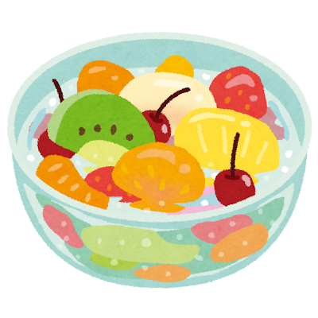

## Claude すげぇよ

### 経緯

元からずっとブログはやりたいと考えていたのですが、最近その旨をClaudeに聞いてみたら`ぽまえAstro知らんのか`って言われたんです。そしてとりあえず「何それ」ってClaude Codeに投げてみたんです。

そしたら説明してくれた上で数回会話してたらなんか勝手に作ってくれました。

すげぇよ。ほんとに。

今後はここは備忘録として利用する予定でいます。普通にmdでかけるの楽しすぎるから多分めっちゃ執筆できる(適当)

以下mdちゃんと使えるのかテスト

- one
  - one-a
  - one-b
- two
  - two-a
  - two-b
  - two-c
- three



```cpp
#include <iostream>
using namespace std;

int main(){
  cout << "Hello World!!" << endl;
}
```

> トグルってどうやってやるんすかね
>
> これどっちかというと引用では？？？？

**FIGHT**

*WHAT*

***WHAT THE HELL!?***

<iframe allow="autoplay *; encrypted-media *;" frameborder="0" height="150" style="width:100%;max-width:660px;overflow:hidden;background:transparent;" sandbox="allow-forms allow-popups allow-same-origin allow-scripts allow-storage-access-by-user-activation allow-top-navigation-by-user-activation" src="https://embed.music.apple.com/jp/album/clairvoyance-siqlo-vs-aois-liarvoyants-rmx/1589643155?i=1589643502"></iframe>

<h1>はっ倒すぞベイベー！</h1>
